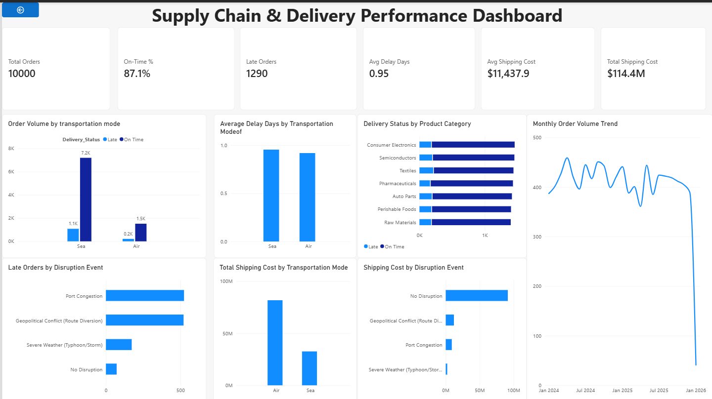

# Freight Transit & Cost Performance Dashboard

## Overview
An interactive Power BI dashboard designed to analyze freight transportation performance, delivery reliability, shipping costs, and disruption events. The dashboard helps identify delivery delays, compare transportation modes, and understand cost patterns across freight operations.

## Objectives
- Analyze overall order volume and on-time delivery performance.
- Track late orders and average delivery delays.
- Compare shipping costs across transportation modes.
- Explore the relationship between disruption events and delivery performance.
- Identify trends in freight operations using interactive visualizations.

## Key Performance Indicators
- **Total Orders:** 10,000
- **On-Time Delivery:** 87.1%
- **Late Orders:** 1,290
- **Average Delay:** 0.95 days
- **Total Shipping Cost:** Approximately $114.4 million
- **Average Shipping Cost per Order:** Approximately $11,437.90

## Dashboard Visualizations
- Order volume by transportation mode and delivery status
- Late orders by disruption event
- Average delay by transportation mode
- Total shipping cost by transportation mode
- Delivery status by product category
- Shipping cost by disruption event
- Monthly order volume trend

## Tools & Technologies
- Microsoft Power BI Desktop
- Power Query for data preparation
- DAX for KPI calculations and measures
- CSV dataset

## Project File
The Power BI report is available in this repository as `Supply_Chain_Delivery_Performance.pbix`.

## How to Use
1. Download the `.pbix` file from this repository.
2. Open it using Power BI Desktop.
3. Refresh the data source if required.
4. Explore the report visualizations and KPIs.

## Future Improvements
- Add dedicated pages for service performance, disruptions, and cost analysis.
- Introduce slicers for date, transportation mode, and delivery status.
- Add deeper analysis of factors associated with late deliveries.

---
**Project:** Freight Transit & Cost Performance Dashboard  
**Built with:** Microsoft Power BI, Power Query, and DAX
